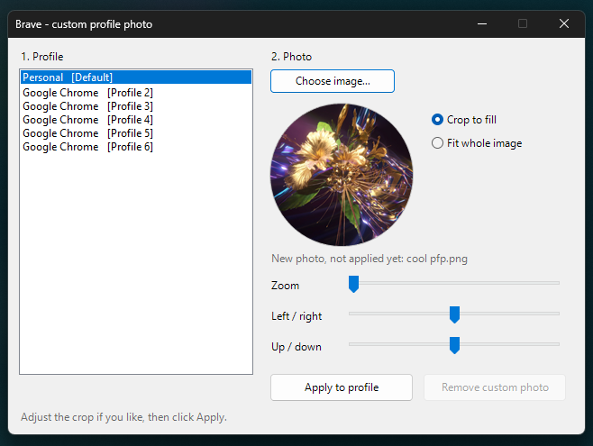

# Brave custom profile photo

My proposed implementation for a brave feature wanted for 4 years.




Use your own image as a Brave profile avatar, in place of one of the built-in icons. The photo shows up in the profile menu, the profile picker, the toolbar avatar and the Windows taskbar/shortcut icon.

This is uses a .cmd script that points to the .ps1, basically in between adding a feature to the GUI and doing band aid file modifications. Maybe could be implemented in the settings somehow...

**NOTE:** Also a pretty early in development script. Depending on bugs I find I will fix accordingly.

## How to use it
Requirements (Version v1.0 - 10.31.26): Windows 10/11 only. Brave, at least v1.98.63

1. Highly recommended to close brave (and background process) first. if not step 5 will do it
2. Unzip this folder
3. Double-click `Brave Custom Avatar.cmd`.
   If Windows says "Windows protected your PC", click **More info > Run anyway**.
   Or right-click the zip first, choose **Properties**, then tick **Unblock**.
4. Pick a profile, click **Choose image...**, adjust zoom and position, then
   click **Apply to profile** (This could take up to 30 seconds)
5. If Brave is open, the tool offers to close it. brave MUST be fully closed
   while the change is saved. When the tool is done it offers to reopen Brave.

To go back to a built-in avatar, simply select the profile and click **Remove custom photo**.

## Command line
For people who prefer using CLI via powershell, also very useful for bulk if you have a ton of profiles.

```powershell
.\Brave-CustomAvatar.ps1 -List
.\Brave-CustomAvatar.ps1 -ProfileName "Personal" -Image C:\Pics\me.jpg -CloseBrave
.\Brave-CustomAvatar.ps1 -ProfileName "Profile 2" -Image .\logo.png -Mode Fit
.\Brave-CustomAvatar.ps1 -ProfileName "Personal" -Image .\me.jpg -Zoom 1.5 -FocusY 0.3
.\Brave-CustomAvatar.ps1 -ProfileName "Personal" -Remove
```

`-ProfileName` takes either the profile's name or its folder name (`Default`,
`Profile 1`, and so on). You can also use `-Channel Beta|Nightly`,
`-UserDataDir <path>` and `-Size 64..1024`. The default size is 256 px.

## How does it work?

Brave is built on Chromium, and Chromium keeps a "profile photo" slot for every
profile: a file called `Google Profile Picture.png` in the profile folder, plus
two switches. Chrome fills that slot from your Google account. Brave turns off
the service that would do that, so nothing ever overwrites or clears a photo
you put there yourself.

The tool:
- crops and resizes your image to a square PNG, applying the camera's rotation
  from the photo's EXIF data,
- writes the PNG to `User Data\<profile>\Google Profile Picture.png`,
- sets `use_gaia_picture` and `gaia_picture_file_name` for that profile in
  `User Data\Local State`, and `profile.using_gaia_avatar` in the profile's
  `Preferences`. These are the same switches Chromium's own "use profile photo"
  setting flips. Only those values change. The rest of each file is left
  byte-for-byte as it was.

Before every change it copies the old files to
`User Data\Custom Avatar Backups\<date-time>\`. To undo by hand, close Brave and
copy them back.

## Things to know

- **Brave must be closed when you apply.** I know it's the third time I mentioned, but based on what I experienced, brave rewrites `Local State` when it
  exits, so a change saved while it's running would be lost
- **Settings > Customize profile won't show your photo as a choice.** Chromium
  only lists the photo there for profiles signed in to a Google account. If you
  click a built-in avatar there, the photo turns off. Run the tool again to turn
  it back on
- Supported formats: PNG, JPEG, BMP, GIF and TIFF. WebP and HEIC also work if
  Windows has the codec installed (the free "WebP Image Extensions", and for
  HEIC the "HEIF" and "HEVC" extensions). Otherwise, save the image as JPEG or
  PNG first
- Requires Windows PowerShell 5.1 (built into Windows 10 and 11) or PowerShell 7

## Credits
https://github.com/brave/brave-browser

https://community.brave.app/t/cannot-set-custom-profile-avatar-in-brave-inconsistent-with-other-chromium-based-browsers/651521

https://community.brave.app/t/allow-custom-avatars-for-brave-profiles/650107

https://community.brave.com/t/set-custom-avatars-to-brave-working/467082

https://community.brave.com/t/custom-avatars-in-profiles/102916

https://github.com/brave/brave-browser/issues/27300

https://github.com/ungoogled-software/ungoogled-chromium/issues/3747